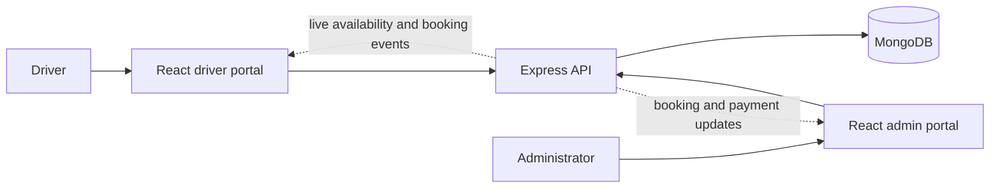

<div align="center">


<h1>Smart Parking, made simple</h1>
<p><strong>Find a space. Book ahead. Arrive without the search.</strong></p>


<a href="https://github.com/swapnildutta10/Smart-Parking/commits/main"></a>
<a href="https://github.com/swapnildutta10/Smart-Parking"></a>

<p><a href="#features">Features</a> · <a href="#architecture">Architecture</a> · <a href="#quick-start">Quick start</a> · <a href="#run-locally">Run locally</a></p>

</div>

ParkNova is a full-stack parking platform with separate driver and administrator portals, live availability, reservations, and booking management.

## Features

**Driver portal**
- Find parking and check availability for a planned arrival.
- Reserve, manage, and pay for bookings; save vehicles and favorite locations.
- View receipts, notifications, and support replies.

**Administrator portal**
- Manage parking locations, inventory, rates, and bookings.
- Review users, payments, and support requests.
- Track activity and export date-filtered reports.

## Architecture



**Stack:** React · Node.js · Express · MongoDB · Three.js · Server-sent events

## Quick start

**Requirements:** Node.js 20.19+ and MongoDB.

```sh
git clone https://github.com/swapnildutta10/Smart-Parking.git
cd Smart-Parking
npm --prefix Backend ci
npm --prefix Frontend ci
npm --prefix Frontend/User ci
npm --prefix Frontend/Admin ci
```
