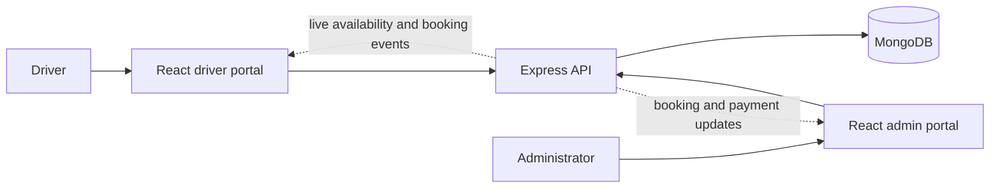

<div align="center">


<h1>Smart Parking, made simple</h1>
<p><strong>Find a space. Book ahead. Arrive without the search.</strong></p>


<a href="https://github.com/swapnildutta10/Smart-Parking/commits/main"></a>
<a href="https://github.com/swapnildutta10/Smart-Parking"></a>

<p><a href="#features">Features</a> · <a href="#architecture">Architecture</a> · <a href="#installation">Installation</a> · <a href="#run-locally">Run locally</a> · <a href="#build-and-checks">Build and checks</a></p>

</div>

ParkNova is a full-stack parking reservation application with separate driver and administrator portals. Drivers can find parking, check capacity for their arrival time, reserve a space, and manage bookings. Administrators manage locations, inventory, reservations, support requests, and reports.

## Features

### Driver portal

- Registration, password login with image CAPTCHA, and profile updates.
- Browse parking locations and vehicle types with hourly INR pricing.
- Live availability for the current time or a planned arrival and duration, with server-sent events and fallback refreshes.
- Create reservations, view booking details and history, check in, and cancel eligible bookings.
- Save vehicles and favorite parking locations to your account.
- Simulated UPI and net banking checkout, promo validation, saved receipts, and payment/refund history.
- Personal dashboard with reservation activity, upcoming bookings, and parking capacity.
- In-app booking notifications and arrival reminders.
- Submit support requests and read administrator replies.
- Responsive interface with light/dark themes and a Three.js parking scene.

### Administrator portal

- Environment-configured administrator login with image CAPTCHA.
- Create parking locations and manage inventory, capacity, vehicle types, and rates.
- Manage booking statuses, including check-in, completion, cancellation, and no-show.
- View registered users, payment history, and support requests; reply to support tickets.
- Dashboard and date-filtered reports with booking and simulated payment/refund totals, plus CSV export.
- Live booking/payment updates with fallback polling.

**Payment scope:** checkout is a test simulation. No payment gateway is connected and no funds are transferred. Availability represents reservation capacity, rather than physical sensors or individually assigned parking bays. Notifications and support replies are delivered inside the app.

## Technology

- **Frontend:** React 19, Create React App, Bootstrap (driver app), custom CSS, Three.js.
- **Backend:** Node.js, Express 5, Mongoose, MongoDB, SVG CAPTCHA.
- **Authentication:** signed session tokens and scrypt password hashing for user accounts.
- **Live updates:** server-sent events (SSE).

## Architecture



## Project structure

```text
Smart-Parking/
├── Backend/
│   ├── controllers/
│   ├── middleware/
│   ├── models/
│   ├── routes/
│   ├── services/
│   ├── package.json
│   └── server.js
├── Frontend/
│   ├── Admin/          # Administrator React application
│   ├── User/           # Driver React application
│   ├── server/         # API integration checks and connection helper
│   └── package.json    # API startup and integration-check scripts
└── README.md
```

## Prerequisites

- Node.js **20.19.0 or newer** and npm, as required by the installed MongoDB/Mongoose dependencies.
- Git.
- A running local MongoDB instance or a MongoDB Atlas connection string. For Atlas, configure database credentials and allow access from your development machine.

## Installation

Run these commands from a terminal:

```sh
git clone https://github.com/swapnildutta10/Smart-Parking.git
cd Smart-Parking
npm --prefix Backend ci
npm --prefix Frontend ci
npm --prefix Frontend/User ci
npm --prefix Frontend/Admin ci
```

Each folder has its own package manifest and lockfile. Installing at the repository root is not sufficient.

## Environment configuration

Create `Backend/.env` with your own values:

```dotenv
PORT=5000
MONGO_URI=mongodb://127.0.0.1:27017/Smart-Parking
JWT_SECRET=replace-with-a-random-secret-at-least-32-characters-long
ADMIN_EMAIL=admin@example.com
ADMIN_PASSWORD=replace-with-your-own-admin-password
CORS_ORIGINS=http://localhost:3000,http://localhost:3001
TEST_PAYMENTS_ENABLED=true
```

Generate a random signing secret with:

```sh
node -e "console.log(require('node:crypto').randomBytes(48).toString('hex'))"
```

Replace `JWT_SECRET` with that output. Use your own Atlas URI in `MONGO_URI` if applicable; URL-encode special characters in its password. The API explicitly uses the `Smart-Parking` database. Administrator credentials come from `ADMIN_EMAIL` and `ADMIN_PASSWORD`; registering a driver does not create an administrator.

The running API requires **`MONGO_URI`**, not `MONGODB_URI`. `Frontend/.env.example` belongs to the separate MongoDB connection helper and is not the backend configuration template.

Create `Frontend/User/.env`:

```dotenv
PORT=3000
REACT_APP_API_URL=http://localhost:5000/api
```

Create `Frontend/Admin/.env`:

```dotenv
PORT=3001
REACT_APP_API_URL=http://localhost:5000/api
REACT_APP_USER_SITE_URL=http://localhost:3000
```

Keep secrets in `Backend/.env`. React environment values are included in the browser bundle and must contain only public configuration. `.env` files and `node_modules` are ignored by Git. Restart the relevant process after changing environment values.

## Run locally

Open three terminals, each starting from the cloned repository root.

**Terminal 1 — API**

```sh
npm --prefix Backend start
```

For automatic API restarts during development, use `npm --prefix Backend run dev` instead.

**Terminal 2 — driver portal**

```sh
npm --prefix Frontend/User start
```

**Terminal 3 — administrator portal**

```sh
npm --prefix Frontend/Admin start
```

| Service | Local URL |
| --- | --- |
| Driver portal | http://localhost:3000 |
| Administrator portal | http://localhost:3001 |
| API readiness check | http://localhost:5000/health |

The health endpoint returns `200` with `database: "connected"` when ready.

### First use

1. Open the administrator portal and sign in using the credentials configured in `Backend/.env`; complete the CAPTCHA.
2. Create a location in **Parking locations**.
3. Add inventory for that location in **Parking inventory**, including vehicle type, hourly rate, and total capacity. A location alone does not create bookable inventory.
4. Open the driver portal, register an account, and sign in.
5. Browse parking or use **Live availability**, select an arrival time and duration, and make a reservation.
6. Try the simulated payment flow and review bookings, receipts, notifications, and support history.

## Build and checks

Create production frontend bundles:

```sh
npm --prefix Frontend/User run build
npm --prefix Frontend/Admin run build
```

Output is written to each application's `build/` directory. Build output requires a static host; the Express API is started separately. Set frontend API URLs before building, and configure backend CORS for the deployed frontend origins.

Run frontend tests once:

```sh
npm --prefix Frontend/User test -- --watchAll=false
npm --prefix Frontend/Admin test -- --watchAll=false
```

API integration checks require the API to be running and `Backend/.env` to be configured. Use a separate development/test database: checks create and remove their own records. From `Frontend/`, examples include:

```sh
npm run test:auth
npm run test:captcha
npm run test:parking
npm run test:catalog
npm run test:availability
npm run test:live-events
npm run test:payments
npm run test:reporting
```

Additional scripts cover saved locations, notifications, support, the user dashboard, and profile updates. See [the API feature and integration-check guide](Frontend/server/README.md) for details.

## Troubleshooting

- **API exits on startup:** check `MONGO_URI`, MongoDB connectivity, and a `JWT_SECRET` of at least 32 characters. Administrator login also needs `ADMIN_EMAIL` and `ADMIN_PASSWORD`.
- **Browser cannot reach the API:** confirm the API is running on port 5000 and `REACT_APP_API_URL` ends in `/api`. Restart React after changing its `.env` file.
- **CORS errors:** include the exact browser origin (scheme, host, and port) in `CORS_ORIGINS`. `localhost` and `127.0.0.1` are different origins.
- **Port already in use:** stop the conflicting process or choose another port in the app's `.env`; update CORS and any affected URLs too.
- **No parking appears:** create both an active location and inventory through the administrator portal.
- **CAPTCHA rejected:** request a new image. Challenges expire after five minutes and are single use, including failed login attempts.
- **Test checkout unavailable:** check `TEST_PAYMENTS_ENABLED`. In production, test payments require an explicit `true`; set it to `false` to disable simulation.

## Deployment notes

The API must remain connected to MongoDB. SSE broadcasts currently operate within one API process; multiple workers need shared pub/sub for immediate updates across workers. Fallback polling remains available. Arrival reminders are generated when notification history is read; external push, email delivery, sensor integration, and a real payment gateway are not implemented.
